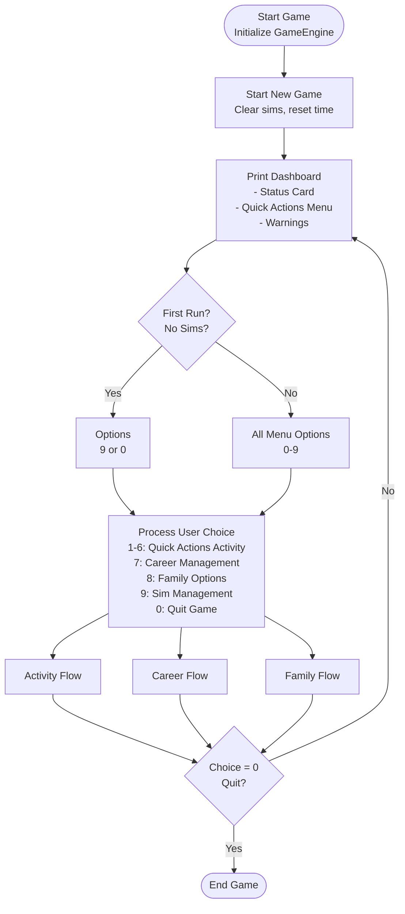
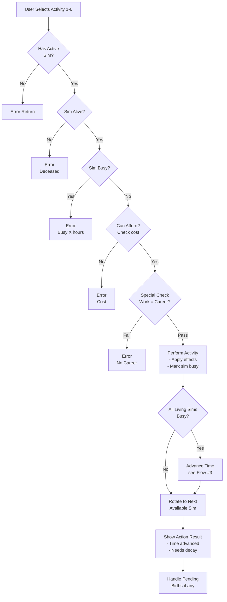
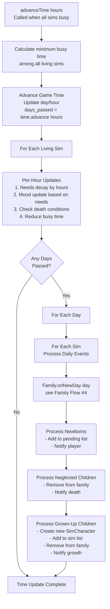
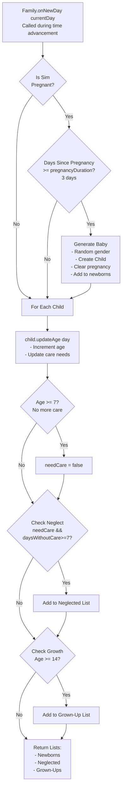
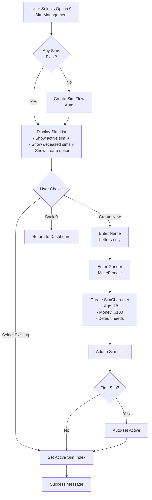
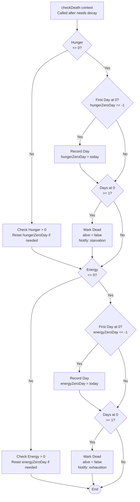

# Sims Game - Flow Charts

This document contains flowcharts describing the game flow of the text-based Sims game.

---

## 1. Main Game Loop

---

## 2. Activity Execution Flow

---

## 3. Time Advancement & Updates Flow

---

## 4. Family & Child Events Flow

---

## 5. Sim Creation/Selection Flow

---

## 6. Death Check Flow

---

## Summary of Key Game Mechanics

### Busy System

- When a sim performs an activity, they become "busy" for the activity duration
- Busy sims cannot perform new actions
- When **all living sims** are busy, time automatically advances
- Time advances by the **minimum remaining busy time** among all sims
- After time advances, all sims' busy counters are reduced

### Time Advancement Triggers

1. **Automatic**: When all living sims become busy
2. **During advancement**:
   - Needs decay based on hours passed
   - Mood updates based on current needs
   - Death checks are performed
   - Daily events are processed (pregnancy, child aging)

### Family System

- **Pregnancy**: Takes 3 days, results in newborn
- **Newborns**: Require care, player must name them
- **Children**:
  - Age 0-6 days: Require daily care
  - Age 7+ days: No longer need care
  - Age 14+ days: Grow up into new playable Sim
- **Neglect**: Child dies if needing care for 7+ days without care

### Death System

- Occurs when **Hunger** or **Energy** remains at 0 for 1 full day
- Game continues until all sims are dead
- Dead sims cannot perform actions but remain in the sim list

### Activity Flow Summary

1. User selects sim (or game auto-rotates to available sim)
2. User selects activity
3. Activity checks pass (alive, not busy, afford, requirements)
4. Activity is applied (needs change, money changes)
5. Sim becomes busy for activity duration
6. **If all living sims busy**: Time advances → Needs decay → Mood update → Family events → Death checks
7. Game rotates to next available sim
8. User sees results and can continue

This architecture ensures a turn-based simulation where time progresses naturally based on sim actions and busy states.
