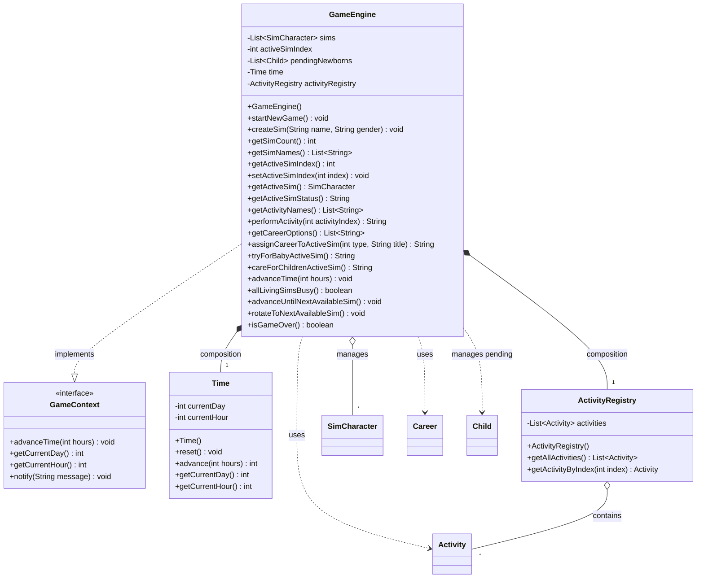
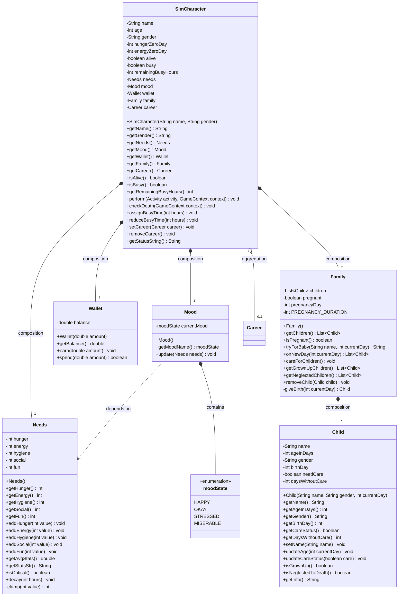
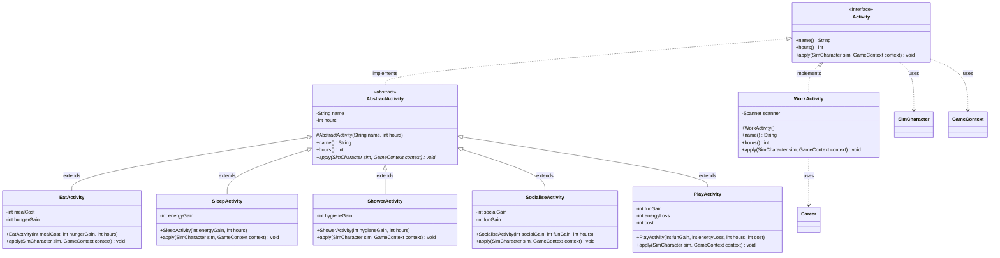
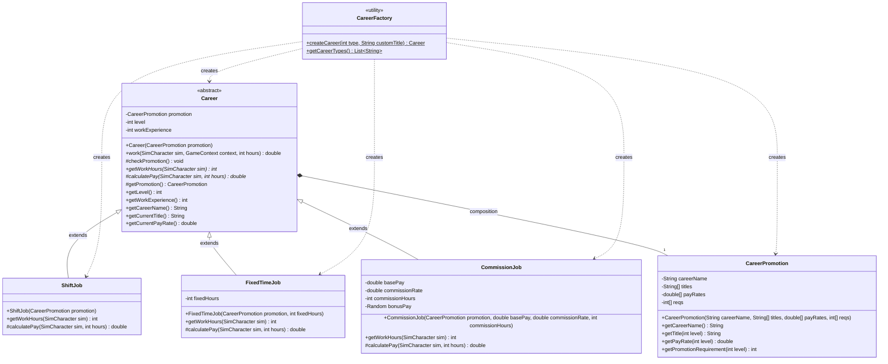

# Sims Game - UML Class Diagrams

This document contains comprehensive UML class diagrams for the text-based Sims game, showing all classes and their relationships.

---

## 1. Complete System Overview

```mermaid
classDiagram
    %% Main Classes
    class Main {
        +main(String[] args)$ void
    }

    class ConsoleUI {
        -GameEngine engine
        -Scanner sc
        +ConsoleUI(GameEngine engine)
        +run() void
    }

    class GameEngine {
        -List~SimCharacter~ sims
        -int activeSimIndex
        -List~Child~ pendingNewborns
        -Time time
        -ActivityRegistry activityRegistry
        +startNewGame() void
        +createSim(String name, String gender) void
        +performActivity(int activityIndex) String
        +advanceTime(int hours) void
        +isGameOver() boolean
    }

    %% Interfaces
    class GameContext {
        <<interface>>
        +advanceTime(int hours) void
        +getCurrentDay() int
        +getCurrentHour() int
        +notify(String message) void
    }

    %% Engine Components
    class Time {
        -int currentDay
        -int currentHour
        +reset() void
        +advance(int hours) int
        +getCurrentDay() int
        +getCurrentHour() int
    }

    class ActivityRegistry {
        -List~Activity~ activities
        +getAllActivities() List~Activity~
        +getActivityByIndex(int index) Activity
    }

    %% Sim Character and Components
    class SimCharacter {
        -String name
        -int age
        -String gender
        -int hungerZeroDay
        -int energyZeroDay
        -boolean alive
        -boolean busy
        -int remainingBusyHours
        -Needs needs
        -Mood mood
        -Wallet wallet
        -Family family
        -Career career
        +perform(Activity activity, GameContext context) void
        +checkDeath(GameContext context) void
        +assignBusyTime(int hours) void
        +reduceBusyTime(int hours) void
    }

    class Needs {
        -int hunger
        -int energy
        -int hygiene
        -int social
        -int fun
        +addHunger(int value) void
        +addEnergy(int value) void
        +addHygiene(int value) void
        +addSocial(int value) void
        +addFun(int value) void
        +getAvgStats() double
        +isCritical() boolean
        +decay(int hours) void
    }

    class Mood {
        -moodState currentMood
        +update(Needs needs) void
        +getMoodName() moodState
    }

    class moodState {
        <<enumeration>>
        HAPPY
        OKAY
        STRESSED
        MISERABLE
    }

    class Wallet {
        -double balance
        +earn(double amount) void
        +spend(double amount) boolean
        +getBalance() double
    }

    class Family {
        -List~Child~ children
        -boolean pregnant
        -int pregnancyDay
        -int PREGNANCY_DURATION$
        +tryForBaby(String name, int currentDay) String
        +onNewDay(int currentDay) List~Child~
        +careForChildren() void
        +getGrownUpChildren() List~Child~
        +getNeglectedChildren() List~Child~
        +removeChild(Child child) void
    }

    class Child {
        -String name
        -int ageInDays
        -String gender
        -int birthDay
        -boolean needCare
        -int daysWithoutCare
        +setName(String name) void
        +updateAge(int currentDay) void
        +updateCareStatus(boolean care) void
        +isGrownUp() boolean
        +isNeglectedToDeath() boolean
    }

    %% Activity Classes
    class Activity {
        <<interface>>
        +name() String
        +hours() int
        +apply(SimCharacter sim, GameContext context) void
    }

    class AbstractActivity {
        <<abstract>>
        -String name
        -int hours
        #AbstractActivity(String name, int hours)
        +name() String
        +hours() int
    }

    class EatActivity {
        -int mealCost
        -int hungerGain
        +apply(SimCharacter sim, GameContext context) void
    }

    class SleepActivity {
        -int energyGain
        +apply(SimCharacter sim, GameContext context) void
    }

    class ShowerActivity {
        -int hygieneGain
        +apply(SimCharacter sim, GameContext context) void
    }

    class SocialiseActivity {
        -int socialGain
        -int funGain
        +apply(SimCharacter sim, GameContext context) void
    }

    class PlayActivity {
        -int funGain
        -int energyLoss
        -int cost
        +apply(SimCharacter sim, GameContext context) void
    }

    class WorkActivity {
        -Scanner scanner
        +name() String
        +hours() int
        +apply(SimCharacter sim, GameContext context) void
    }

    %% Career Classes
    class Career {
        <<abstract>>
        -CareerPromotion promotion
        -int level
        -int workExperience
        +work(SimCharacter sim, GameContext context, int hours) double
        #checkPromotion() void
        +getWorkHours(SimCharacter sim)* int
        #calculatePay(SimCharacter sim, int hours)* double
        +getCareerName() String
        +getCurrentTitle() String
    }

    class ShiftJob {
        +getWorkHours(SimCharacter sim) int
        #calculatePay(SimCharacter sim, int hours) double
    }

    class FixedTimeJob {
        -int fixedHours
        +getWorkHours(SimCharacter sim) int
        #calculatePay(SimCharacter sim, int hours) double
    }

    class CommissionJob {
        -double basePay
        -double commissionRate
        -int commissionHours
        -Random bonusPay
        +getWorkHours(SimCharacter sim) int
        #calculatePay(SimCharacter sim, int hours) double
    }

    class CareerPromotion {
        -String careerName
        -String[] titles
        -double[] payRates
        -int[] reqs
        +getTitle(int level) String
        +getPayRate(int level) double
        +getPromotionRequirement(int level) int
    }

    class CareerFactory {
        <<utility>>
        +createCareer(int type, String customTitle)$ Career
        +getCareerTypes()$ List~String~
    }

    %% Relationships - Main Structure
    Main --> ConsoleUI : creates
    Main --> GameEngine : creates
    ConsoleUI --> GameEngine : uses
    GameEngine ..|> GameContext : implements
    GameEngine *-- Time : composition
    GameEngine *-- ActivityRegistry : composition
    GameEngine o-- SimCharacter : aggregation
    GameEngine o-- Child : manages pending

    %% SimCharacter Relationships
    SimCharacter *-- Needs : composition
    SimCharacter *-- Mood : composition
    SimCharacter *-- Wallet : composition
    SimCharacter *-- Family : composition
    SimCharacter o-- Career : aggregation

    %% Mood Relationships
    Mood *-- moodState : contains
    Mood ..> Needs : depends on

    %% Family Relationships
    Family *-- Child : composition

    %% Activity Relationships
    ActivityRegistry o-- Activity : contains
    Activity <|.. AbstractActivity : implements
    Activity <|.. WorkActivity : implements
    AbstractActivity <|-- EatActivity : extends
    AbstractActivity <|-- SleepActivity : extends
    AbstractActivity <|-- ShowerActivity : extends
    AbstractActivity <|-- SocialiseActivity : extends
    AbstractActivity <|-- PlayActivity : extends

    Activity ..> SimCharacter : uses
    Activity ..> GameContext : uses

    %% Career Relationships
    Career <|-- ShiftJob : extends
    Career <|-- FixedTimeJob : extends
    Career <|-- CommissionJob : extends
    Career *-- CareerPromotion : composition
    CareerFactory ..> Career : creates
    CareerFactory ..> CareerPromotion : creates
```

---

## 2. Core Game Engine Package

---

## 3. SimCharacter and Components Package

---

## 4. Activity Package Hierarchy

---

## 5. Career Package Hierarchy

---

## 6. Relationship Legend and Summary

### Relationship Types Used

| Symbol | Relationship | Description | Example |
|--------|--------------|-------------|---------|
| `*--` | Composition | Strong ownership, part cannot exist without whole | SimCharacter *-- Needs |
| `o--` | Aggregation | Weak ownership, part can exist independently | SimCharacter o-- Career |
| `<|--` | Inheritance | Is-A relationship | EatActivity <\|-- AbstractActivity |
| `<|..` | Implementation | Implements interface | AbstractActivity <\|.. Activity |
| `..>` | Dependency | Uses temporarily | Activity ..> GameContext |
| `-->` | Association | General relationship | Main --> ConsoleUI |

### Key Design Patterns Demonstrated

1. **Factory Pattern**: `CareerFactory` creates different Career types
2. **Strategy Pattern**: `Activity` interface with multiple implementations
3. **Template Method**: `AbstractActivity` provides base implementation
4. **MVC-like**: `GameEngine` (Model), `ConsoleUI` (View/Controller)
5. **Interface Segregation**: `GameContext` provides minimal interface

### Class Count by Package

- **Main**: 2 classes (Main, ConsoleUI)
- **Engine**: 4 classes (GameEngine, GameContext interface, Time, ActivityRegistry)
- **Sims**: 6 classes (SimCharacter, Needs, Mood, moodState enum, Wallet, Family, Child)
- **Activity**: 8 classes (Activity interface, AbstractActivity, 6 concrete activities)
- **Career**: 6 classes (Career abstract, CareerPromotion, CareerFactory, 3 job types)

**Total: 26 classes/interfaces**

### Composition vs Aggregation Examples

**Composition (filled diamond *--):**
- SimCharacter *-- Needs: Needs cannot exist without Sim
- SimCharacter *-- Mood: Mood is part of Sim's identity
- Family *-- Child: Children belong to family unit
- Career *-- CareerPromotion: Promotion structure belongs to career

**Aggregation (hollow diamond o--):**
- SimCharacter o-- Career: Sim can exist without career, career can change
- GameEngine o-- SimCharacter: Sims can exist independently of engine
- ActivityRegistry o-- Activity: Activities exist independently

This demonstrates proper understanding of object ownership and lifecycle management!
